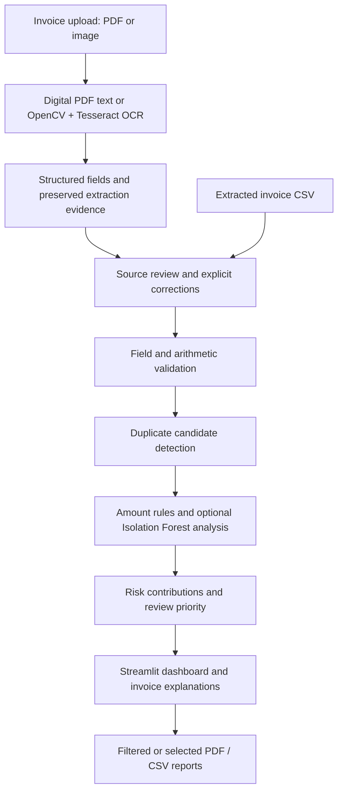

<h1 align="center">Automated Invoice Processing and Anomaly Detection using Machine Learning</h1>

<p align="center"><strong>Turn invoice documents into structured records and explainable review priorities.</strong></p>
<p align="center">OCR extraction · Data validation · Duplicate matching · Machine learning · Interactive reporting</p>

<p align="center">
  <a href="https://invoice-detection.streamlit.app/"></a>
  
  
  
  
  
</p>

<p align="center">
  <a href="https://github.com/Akashshinde84/Automated-Invoice-Processing-and-Anomaly-Detection">GitHub Repository</a> ·
  <a href="#overview">Overview</a> ·
  <a href="#installation">Installation</a> ·
  <a href="#application-workflow">Usage</a> ·
  <a href="#machine-learning-approach">ML Methodology</a> ·
  <a href="#testing">Testing</a> ·
  <a href="#deployment">Deployment</a>
</p>

## Overview

Manual invoice entry makes it easy to miss inconsistent amounts, repeated invoices, and unusual vendor activity. This project brings document extraction and review into one Python application: read PDFs or images, inspect extracted fields, validate records, compare duplicate candidates, and investigate unusual patterns.

Tesseract OCR reduces manual transcription for scanned documents, while digital PDFs can use their text layer directly. Explainable rules and optional Isolation Forest models help prioritize investigation. A Streamlit workspace keeps source evidence, corrections, analysis, and downloadable reports together, supporting more consistent review and traceability.

> **Review support:** Anomaly flags are not proof of fraud. OCR values require source review, and synthetic ML results do not establish real-world detection accuracy.

## Key Features

| Capability | What the application does |
|---|---|
| Multi-invoice upload | Accepts PDF, PNG, JPG, and JPEG files with per-file processing status and preserved source copies. |
| PDF and image extraction | Uses digital-PDF text extraction or OpenCV preprocessing and Tesseract OCR for scanned content. |
| Structured invoice fields | Extracts invoice number, vendor, date, currency, total amount, and supported line-item layouts. |
| Data validation | Checks required fields, dates, monetary values, and arithmetic when supporting components are available. |
| Duplicate candidates | Finds exact-document, exact-field, identity-conflict, and fuzzy matches without deleting records. |
| Rule-based anomalies | Applies currency-specific amount thresholds and vendor-history amount checks. |
| Isolation Forest analysis | Scores eligible records with separate models per currency and saved preprocessing pipelines. |
| Explainable risk scoring | Shows a capped 0–100 heuristic score, priority, contributing factors, and recommended review actions. |
| OCR review and corrections | Preserves original extraction evidence and saves explicit core-field corrections as separate versions. |
| Interactive dashboard | Provides KPI cards, search, filters, invoice explanations, and currency-specific Plotly charts. |
| PDF and CSV reporting | Exports filtered or selected records; private paths and raw OCR columns are excluded by default. |

**Upload limits:** 10 MB per file, 20 files / 50 MB per batch, and 25 pages per PDF. Decoded image/page limits also apply. Analysis supports up to 2,000 records per batch.

## Application Screenshots

Screenshots have not been added yet. The gallery below reserves filenames for real application captures; no missing images are embedded.

| View | Planned relative image path | Capture guidance |
|---|---|---|
| Dashboard Overview | `docs/screenshots/dashboard-overview.png` | Show the KPI cards and review summary. |
| Invoice Upload | `docs/screenshots/invoice-upload.png` | Show a synthetic upload and extraction status. |
| Anomaly Detection | `docs/screenshots/anomaly-detection.png` | Show rule/ML results and score contributions. |
| Invoice Review | `docs/screenshots/invoice-review.png` | Show the core-field correction form. |
| Analytics Charts | `docs/screenshots/analytics-charts.png` | Show distributions and currency-specific vendor totals. |
| Reports | `docs/screenshots/reports.png` | Show report selection and download controls. |

To populate the gallery, create `docs/screenshots/`, capture these views using synthetic data, and save the files with the names above. After each file exists, embed it using relative Markdown, for example:

```markdown

```

Exclude confidential invoices, local file paths, and personal information from captures.

## System Architecture



[Pipeline orchestration](pipeline.py) handles document extraction. [Analysis orchestration](invoice_analysis.py) combines validation, duplicate matching, rules, and eligible model inference. [The dashboard](app.py) presents those results; corrections retain original values and warnings.

## Technologies Used

| Technology | Purpose |
|---|---|
| Python 3.12 | Application runtime and command-line tools |
| Streamlit | Upload, review, analysis, and reporting interface |
| Tesseract + pytesseract | OCR and recognition confidence for scanned content |
| OpenCV Headless + Pillow | Image decoding, thresholding, and conservative deskew |
| PDFium via pypdfium2 | PDF text extraction and page rendering |
| pandas + NumPy | Record processing and numerical features |
| Decimal + python-dateutil | Monetary precision and date parsing |
| RapidFuzz | Vendor and invoice-number similarity matching |
| scikit-learn / Isolation Forest | Preprocessing pipelines and unsupervised outlier detection |
| joblib | Trusted local model persistence |
| Plotly + ReportLab | Interactive charts and PDF reports |
| pytest + Streamlit AppTest + pypdf | Automated behavior checks and report verification |

See [runtime dependencies](requirements.txt), [development dependencies](requirements-dev.txt), and [Linux system packages](packages.txt). Tesseract is installed separately from Python dependencies.

## Installation

### 1. Prepare Windows prerequisites

Install **Python 3.12**, **Git**, and **Tesseract OCR with English language data**. Use PowerShell for the commands below. Tesseract installation guidance is available in the [official documentation](https://tesseract-ocr.github.io/tessdoc/Installation.html).

### 2. Clone the repository

```powershell
git clone https://github.com/Akashshinde84/Automated-Invoice-Processing-and-Anomaly-Detection.git
cd Automated-Invoice-Processing-and-Anomaly-Detection
```

### 3. Create and activate a virtual environment

```powershell
py -3.12 -m venv .venv
.\.venv\Scripts\Activate.ps1
```

If PowerShell blocks activation, continue using the explicit `.venv` interpreter in the commands below. In VS Code, select `.venv\Scripts\python.exe` as the Python interpreter.

### 4. Install dependencies

```powershell
.\.venv\Scripts\python.exe -m pip install -r requirements.txt
.\.venv\Scripts\python.exe -m pip check
```

Use `requirements-dev.txt` instead if you also want test tools. Keep `opencv-python-headless`; installing `opencv-python` alongside it can cause conflicts.

### 5. Verify Tesseract

```powershell
tesseract --version
tesseract --list-langs
```

Ensure `eng` appears in the language list. Discovery checks `TESSERACT_CMD`, PATH, and common Windows installation folders. If necessary, set the actual executable location:

```powershell
$env:TESSERACT_CMD='C:\Program Files\Tesseract-OCR\tesseract.exe'
& $env:TESSERACT_CMD --version
& $env:TESSERACT_CMD --list-langs
```

### 6. Start the application

```powershell
$env:OPENBLAS_NUM_THREADS='1'
$env:OMP_NUM_THREADS='1'
$env:MKL_NUM_THREADS='1'
$env:OPENCV_FOR_THREADS_NUM='1'
.\.venv\Scripts\python.exe -m streamlit run app.py --server.port 8502
```

Open [localhost:8502](http://localhost:8502). A fresh checkout starts with the labeled synthetic demonstration; saved models and generated outputs are not required.

If an updated helper raises `session_storage_root() got an unexpected keyword argument 'temporary'`, stop and restart the Streamlit server to load the current `workflow.py`; refreshing the browser alone can retain an older imported module. On Community Cloud, deploy matching versions of `app.py` and `workflow.py` and reboot the app. Browser upload directories survive ordinary session reruns; restarting the server resets session state, so download needed results first. Temporary files are left for host cleanup rather than deleted during reruns.

## Application Workflow

1. **Open the workspace.** Select the **Invoice Processing** tab. The sidebar's **Upload & Process Invoices** entry points to this same workspace.
2. **Upload source documents.** Choose multiple PDF, PNG, JPG or JPEG files and click **Process Invoices**. Progress and per-file errors appear while the existing OCR pipeline runs directly on the host; no local commands are needed.
3. **Review extracted fields.** Compare values with the original document. Save supported corrections in the upload page or **Invoice Records**. Leave uncertain values unresolved.
4. **Analyze the batch.** Review extracted fields and the rules/duplicate analysis below the uploader. In **Invoice Validation**, choose **Processed uploads** for the full dashboard, configured thresholds, and eligible optional trusted model inference. No synthetic records are substituted for failed uploads.
5. **Investigate findings.** Use **Anomaly Detection** and the invoice explanation selector to inspect reasons, duplicate matches, OCR warnings, and risk contributions.
6. **Download results.** Download the uploaded analysis CSV or prepare a PDF in **Invoice Processing**. Use **Invoice Validation → Reports** for filtered or selected records. Anomaly flags indicate review needs, not confirmed fraud.

You can also upload an extracted CSV through **Extracted invoice CSV**. Byte-identical uploaded documents share one extraction record while all source copies are retained. Other duplicate candidates remain separate records for review.

## How to Run

The [installation guide](#installation) starts the dashboard. The same processing and analysis modules are available from the command line.

### Batch extraction and analysis

Place invoice documents in `invoices/`, then run:

```powershell
.\.venv\Scripts\python.exe main.py invoices --csv output/invoice_run/invoices.csv --output-dir output/invoice_run/processed --raw-dir output/invoice_run/raw_ocr
.\.venv\Scripts\python.exe invoice_analysis.py analyze output/invoice_run/invoices.csv --output output/invoice_run/analysis.csv --config analysis_config.example.json
```

Choose fresh destinations for each run. Extraction can replace its specified CSV; analysis and model commands reject existing destinations. Extraction options include `--date-order`, `--decimal-separator`, `--dpi`, `--psm`, `--threshold`, and `--timeout`. The `--text-input` option replays text for parsing and does not perform OCR.

### Synthetic model evaluation

```powershell
.\.venv\Scripts\python.exe model_evaluation.py --output-dir output/model_evaluation_run --model models/vendor_demo.joblib --as-of 2026-10-29
```

This generates separate synthetic training/evaluation data, model artifacts, and evaluation reports. Use unused output and model paths. The date is an explicit reproducible example.

To train a model on suitable reviewed records:

```powershell
.\.venv\Scripts\python.exe invoice_analysis.py train INPUT.csv --model models/reviewed_model.joblib --kind verified_real
```

Replace `INPUT.csv` with your dataset. Real training requires `human_verified=true` and complete, valid records without unresolved OCR or financial validation errors. Uploading or correcting invoices does not automatically train a model.

## Configuration

[analysis_config.example.json](analysis_config.example.json) documents the validated analysis policy. Use `--config` in the analysis CLI; dashboard controls apply to the current session.

| Setting | Default |
|---|---|
| High amount thresholds | USD / EUR / GBP: 10,000; INR: 500,000 |
| Vendor / invoice similarity | 90 / 85 |
| Duplicate date window | 7 days |
| Monetary comparison tolerance | 0.01 |
| Vendor amount history | At least 5 suitable earlier records; multiplier 4 |
| Vendor Z-score | Absolute score above 3, using at least 5 earlier distinct eligible invoices in the same currency; zero variance is skipped |
| Invoice age | Flag more than 90 days old; configurable with `max_invoice_age_days` |
| Review priority | LOW: 0–24; MEDIUM: 25–59; HIGH: 60–100 |
| ML training minimum | 100 eligible distinct records per currency |

`--as-of YYYY-MM-DD` fixes the reference date; otherwise the application uses India-local time. Amounts in different currencies are not combined or converted.

## Machine Learning Approach

Vendor statistical checks include Z-scores against the mean and population standard deviation of earlier eligible invoices for the same vendor and currency. The current invoice is excluded from its reference history. Both unusually low and high amounts can trigger the configurable absolute threshold. Age flags remain review signals and do not alone disqualify otherwise valid records from ML.

### Project deliverables and technical report

Analysis exports include **`isanomaly`** (True/False) and **`anomalyreason`**, alongside separate rule, validation, duplicate and ML findings. The combined flag covers scored validation findings, amount rules, duplicate candidates and ML outliers; OCR review remains separate. Explicit subtotal, tax, shipping and discount fields are extracted from supported labels for reconciliation; missing components remain unknown.

Generate a four-page technical report, freshly extracted sample CSV, synthetic evaluation CSV, and measured accuracy results using a new output directory:

```powershell
.\.venv\Scripts\python.exe technical_report.py --output-dir output/project_deliverables --as-of 2026-10-29
```

The report documents parsing, mathematical checks, Isolation Forest rationale, core-field OCR recovery against sample ground truth, and currency-specific box/scatter plots. Tesseract and development dependencies are required. Small authored samples and synthetic evaluation do not establish real-world accuracy. The dashboard also includes box plots by vendor and scatter plots colored by combined anomaly status.

### Isolation Forest and preprocessing

Isolation Forest identifies records that are easier to isolate through random feature splits. It provides an unsupervised outlier signal alongside explicit field and amount checks.

Models are fitted **separately per currency**. The default `numeric_v1` profile uses log amount, item count, day of month, and weekday with scaling in a persisted pipeline. The experimental `vendor_v2` profile adds normalized vendor categories and training-fitted vendor frequencies, with median imputation, scaling, and categorical encoding.

Defaults are **200 trees**, **0.05 contamination**, and **random seed 42**. Contamination is a model setting, not an estimate of fraud prevalence. Ineligible records are explicitly skipped rather than assigned a misleading model result.

### Synthetic evaluation and model boundaries

The evaluation tool creates 600 synthetic training records and 280 separate evaluation records using independent generators. Expected labels are stored separately and do not enter training or inference. The built-in dashboard demonstration uses synthetic data as well.

These datasets demonstrate behavior and enable repeatable checks; they do not establish performance on business invoices. The experimental vendor-aware profile underperformed the numeric baseline on the supplied synthetic evaluation. No real-world accuracy claim is made here.

The dashboard offers trusted project-created local models with matching integrity records and disables model uploads. Integrity markers do not make arbitrary pickle/joblib files safe: only load artifacts you trust. Retrain persisted models when scikit-learn versions change.

### Explainable risk scoring

The **0–100 risk score is a heuristic review priority**, distinct from the Isolation Forest decision score.

| Signal | Risk contribution |
|---|---|
| Field validation findings | 10–25 per scored finding; category capped at 40 |
| Strongest duplicate candidate | 20, 25, or 35 |
| Amount rules | 20 per rule; category capped at 30 |
| Eligible verified-real model outlier | 15 |
| Synthetic model outlier / OCR uncertainty | 0; OCR review is tracked separately |

**Anomaly scores are not fraud probabilities.** LOW priority does not mean approved: a USD 50,000 invoice against a USD 10,000 threshold contributes 20/LOW from that signal alone and still warrants review. Filtering completed results does not recompute scores; changing the input batch can change duplicate and vendor-history evidence.

## Dashboard Features

| Navigation section | Review tasks |
|---|---|
| Dashboard | Inspect invoice KPIs, review summaries, charts, filtered records, and explanations. |
| Upload & Process Invoices | Extract multiple documents, inspect status, and review core fields. |
| Invoice Records | Search/filter records, correct core fields, and inspect original values and correction history. |
| Anomaly Detection | Examine rule/ML findings, score contributions, duplicate candidates, and charts. |
| Reports | Download filtered or selected PDF/CSV records. |
| Settings | Inspect validated configuration and adjust sidebar controls and trusted model selection. |

**KPIs** include invoice count, rule flags, duplicate candidate records, high priority records, OCR review requirements, validation status, and ML outliers. Validation counts describe field checks; they do not certify OCR accuracy or payment approval.

**Charts** show risk distributions, priorities, observed amounts, vendor totals, duplicate candidate counts, and rule/validation frequencies. Monetary charts use one currency at a time. **Filters** cover vendor, currency, date range, anomaly status, priority, and OCR review status.

Each invoice explanation includes reasons, point contributions, duplicate details, OCR uncertainty, and suggested manual actions, with optional technical details. The **Invoice Processing** tab processes documents directly in the browser; command-line usage remains available under **How to Run**.

## Project Structure

```text
.
├── app.py                         # Streamlit entry point
├── dashboard_ui.py                # Upload, review, charts, explanations, reports
├── workflow.py                    # Storage, upload validation, corrections, filters
├── main.py                        # Document extraction CLI
├── pipeline.py                    # Extraction orchestration and serialization
├── preprocessing.py               # Image and PDF preprocessing
├── ocr_engine.py                  # Digital text extraction and Tesseract OCR
├── parser.py                      # Invoice field and line-item parsing
├── invoice_analysis.py            # Analysis and model-training CLI
├── analysis_config.py             # Validated settings
├── analysis_config.example.json   # Example analysis policy
├── validator.py                   # Field and arithmetic validation
├── duplicate_detector.py          # Duplicate candidate matching
├── anomaly_detector.py            # Amount rules, model training and inference
├── model_evaluation.py            # Synthetic evaluation and reports
├── reporting.py                   # PDF and CSV export
├── samples/                       # Synthetic fixtures and generator
├── tests/                         # Automated tests
├── .streamlit/
│   └── config.toml                # Theme, upload cap, server settings
├── requirements.txt               # Runtime dependencies
├── requirements-dev.txt           # Test dependencies
├── packages.txt                   # Linux hosting dependencies
├── .gitignore
├── LICENSE
└── README.md
```

This tree highlights the main application files. Virtual environments, caches, temporary files, generated artifacts, and private invoice data are omitted.

## Testing

From the repository root:

```powershell
.\.venv\Scripts\python.exe -m pip install -r requirements-dev.txt
.\.venv\Scripts\python.exe -m pytest tests -q -ra -p no:cacheprovider
.\.venv\Scripts\python.exe -m pip check
```

Tests cover preprocessing, digital/scanned PDFs, parsing, monetary validation, duplicates, risk boundaries, model persistence/inference, evaluation separation, upload handling, correction provenance, filters, charts, reporting privacy, and Streamlit pages. Real OCR tests require Tesseract and report an explicit skip reason when it is unavailable.

Streamlit AppTest checks UI behavior; manual browser upload/download checks and a successful Linux/cloud build are separate validations.

## Deployment

**The application is deployed on Streamlit Community Cloud.**

**Public application URL:** [https://invoice-detection.streamlit.app/](https://invoice-detection.streamlit.app/)

### Deploy your own instance

Deploy through [Streamlit Community Cloud](https://share.streamlit.io/) using the [official deployment guide](https://docs.streamlit.io/deploy/streamlit-community-cloud/deploy-your-app/deploy).

1. Connect GitHub and select this repository and the branch you intend to deploy.
2. Set the app entry point to **`app.py`** and select **Python 3.12** in Advanced settings.
3. Keep [requirements.txt](requirements.txt), [packages.txt](packages.txt), and [.streamlit/config.toml](.streamlit/config.toml) in their supplied locations. System packages provide Tesseract, English language data, and DejaVu fonts; PDFium handles PDFs without Poppler.
4. Add the following top-level setting in **Advanced settings → Secrets** for a public demonstration:

   ```toml
   INVOICE_STORAGE_MODE = "session"
   ```

5. Deploy, inspect build/runtime logs, and verify all navigation pages, synthetic uploads, and PDF/CSV downloads on the running host.

### Storage and uploaded invoice privacy

Browser document uploads always use a unique OS temporary directory per Streamlit session, including in local mode. Original copies and extraction/review versions remain isolated within that temporary directory using platform-independent paths. CLI extraction continues to use the destinations you specify. Session mode also disables automatic loading of repository-local extraction CSVs. Reports are generated in memory.

On Streamlit Community Cloud, keep `tesseract-ocr` and `tesseract-ocr-eng` in `packages.txt`, along with the report fonts. `requirements.txt` supplies `pytesseract`, OpenCV Headless and `pypdfium2`; PDFium handles PDF text extraction and rendering without external Poppler commands. Scanned PDFs and images need Tesseract, while supported digital PDFs can use their text layer. After changing dependencies, reboot/redeploy and inspect the build logs. Remove any Windows `TESSERACT_CMD` override on Linux. A missing OCR tool or corrupt document produces a per-file error; successful files in the same batch remain available for review and download.

If processing reports that upload storage is not writable, check the server traceback. On Windows, launch Streamlit from a normal terminal with the project environment; a restricted execution token can create a temporary directory but be denied access to its children. Restarting outside that restricted context preserves secure temporary-directory permissions; do not grant broad filesystem access or disable upload checks. On Linux/cloud, ensure the host temporary directory is writable by the app account and check disk capacity. Storage setup, CSV persistence, document extraction and reporting failures are logged with tracebacks on the server; browser errors and upload previews redact host paths. Keep server logs private.

Temporary host storage is not durable. Download required results before restarting or leaving; files may remain on the host until recycling. Session isolation does not provide authentication, encryption, or guaranteed deletion. Use synthetic invoices for public demonstrations and establish access control and retention policies before handling confidential records.

For local session-mode testing, set `$env:INVOICE_STORAGE_MODE='session'` before launching. Remove Windows-specific `TESSERACT_CMD` overrides on Linux. Keep credentials and `.streamlit/secrets.toml` out of Git; review tracked files before publishing because ignore rules do not untrack existing files.

## Limitations

- **OCR and layout coverage:** Recognition can misread dates, punctuation, amounts, and line items. Confidence is not proof of correctness; the parser supports selected layouts rather than arbitrary documents.
- **Human review:** Compare uncertain fields with the source. Core-field corrections do not certify every line item or clear all OCR warnings. Ambiguous dates remain unresolved without issuer context; missing financial components are not assumed zero.
- **Duplicate interpretation:** Matches can represent legitimate copies or revisions, especially when OCR is uncertain. Candidates are not automatically deleted or rejected.
- **ML generalization:** Synthetic evaluation does not establish real-world fraud accuracy. False positives and false negatives are possible; unusual invoices may be legitimate.
- **Hosting and persistence:** Cloud resource limits and temporary storage affect availability and retention. The application does not provide authenticated multi-user accounting storage or automatic payment approval.

## Future Enhancements

These are proposed improvements, not current capabilities:

- Broader OCR layout coverage and stronger source-grounded extraction confidence.
- Evaluation on diverse, consented, manually verified real-world invoice datasets.
- Model monitoring for drift, data quality, and changing outlier rates.
- Richer explanations and independently evaluated vendor-pattern features.
- Secure user authentication and role-based review workflows.
- Database integration with durable storage and explicit retention policies.

## Author and License

Created by **Akash Shinde** — [GitHub: Akashshinde84](https://github.com/Akashshinde84).

Released under the **MIT License**. See [LICENSE](LICENSE) for the full terms.
