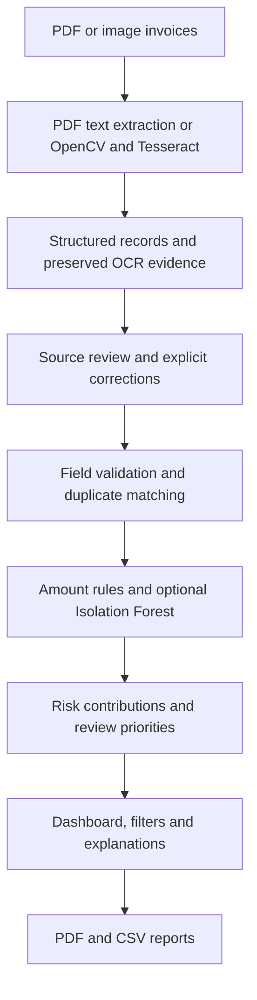

# Automated Invoice Processing and Anomaly Detection using Machine Learning

## Overview

A Python application for extracting invoice information, validating records,
identifying duplicate candidates and unusual patterns, and organizing manual
review in a Streamlit dashboard. The application combines document processing,
explainable rules, Isolation Forest, and downloadable reports in one workflow.

Anomaly flags are review signals, not proof of fraud. OCR results require source
review, and synthetic model evaluations do not establish real-world accuracy.

## Key Features

- PDF, PNG, JPG and JPEG invoice processing with preserved source copies.
- Reliable digital-PDF text extraction with OCR fallback for scanned content.
- OpenCV preprocessing, Tesseract confidence, original text and recognition evidence.
- Invoice number, vendor, date, currency and Decimal amount extraction.
- Field validation and totals reconciliation when supporting values are available.
- Exact-document, exact-field, identity-conflict and fuzzy duplicate candidates.
- Configurable amount rules and currency-specific Isolation Forest models.
- Explainable 0–100 risk scores and separate OCR review statuses.
- Source-preserving corrections, searchable records and currency-aware charts.
- Scoped PDF/CSV exports with private paths and raw OCR columns excluded by default.

## Technologies Used

| Area | Technologies |
|---|---|
| Application | Python 3.12, Streamlit |
| Document processing | Tesseract, pytesseract, OpenCV Headless, Pillow, PDFium |
| Data and matching | pandas, NumPy, Decimal, python-dateutil, RapidFuzz |
| Machine learning | scikit-learn Isolation Forest, preprocessing pipelines, joblib |
| Visualization and reports | Plotly, ReportLab |
| Testing | pytest, Streamlit AppTest, pypdf |

Runtime dependencies are in `requirements.txt`; development and report-verification
dependencies are in `requirements-dev.txt`. Tesseract is a separate system program.

## System Architecture



`pipeline.py` coordinates extraction. `invoice_analysis.py` coordinates validation,
duplicate matching, rules and optional model inference. `app.py` and its UI helpers
present results without recalculating the detection policy. Corrections retain
original values and warnings; reports use the analyzed records and selected scope.

## Installation

### Windows and VS Code

Open the repository folder in VS Code and use PowerShell:

```powershell
# Create the environment only if it does not already exist:
py -3.12 -m venv .venv
.\.venv\Scripts\python.exe -m pip install -r requirements-dev.txt
.\.venv\Scripts\python.exe -m pip check
```

Select `.venv\Scripts\python.exe` as the VS Code interpreter. Activation is optional.
For runtime installation without test tools, install `requirements.txt` instead.
Use headless OpenCV; do not install `opencv-python` alongside `opencv-python-headless`.

Install Tesseract with English language data separately. Check:

```powershell
tesseract --version
tesseract --list-langs
```

Discovery checks `TESSERACT_CMD`, PATH and common Windows installation folders. If
necessary, set the actual installed executable path:

```powershell
$env:TESSERACT_CMD='C:\Program Files\Tesseract-OCR\tesseract.exe'
& $env:TESSERACT_CMD --version
```

### Linux hosting dependencies

`packages.txt` declares Tesseract, English language data and DejaVu fonts for
Streamlit Community Cloud. PDFium handles PDF extraction/rendering; Poppler is
not needed. Remove Windows-specific executable overrides on Linux.

## Configuration

`analysis_config.example.json` documents the validated analysis settings. Supply
`--config` to the analysis CLI; dashboard settings apply to the current session.

| Setting | Default |
|---|---|
| High amount limits | USD/EUR/GBP 10,000; INR 500,000 |
| Vendor / invoice similarity | 90 / 85 |
| Duplicate date window | 7 days |
| Monetary comparison tolerance | 0.01 |
| Vendor history | At least 5 suitable earlier records; amount multiplier 4 |
| Review priorities | LOW below 25; MEDIUM 25–59; HIGH at least 60 |
| ML training minimum | 100 eligible distinct records per currency |

`--as-of YYYY-MM-DD` makes date checks reproducible. Otherwise the reference date
uses India-local time. Different currencies are not combined or converted.

Upload limits are 10 MB/file, 20 files/50 MB per batch and 25 PDF pages, with decoded
image/page pixel limits. Analysis accepts at most 2,000 records per batch.

### Storage and privacy

Local mode retains source copies under `invoices/uploads/` and separate extraction
and review versions under `output/runs/`. No automatic cleanup removes user data.
For a hosted public demonstration, set this top-level value in Streamlit Advanced
settings → Secrets; never commit `.streamlit/secrets.toml`:

```toml
INVOICE_STORAGE_MODE = "session"
```

Session mode uses a unique OS temporary directory per browser session and disables
automatic loading of repository-local extraction CSVs. Reports are generated in
memory. Download required results before restarting or leaving: temporary host
storage is not durable. Files may remain on the running host until recycling.
Session isolation is not authentication, encryption or guaranteed deletion. Use
synthetic samples only in public demonstrations.

`.gitignore` excludes environments, credentials, logs, temporary files, private
invoices, generated outputs, reports, datasets and model artifacts. Ignore rules
do not untrack previously committed files; review staged content before publishing.

## How to Run

### Dashboard

```powershell
$env:OPENBLAS_NUM_THREADS='1'
$env:OMP_NUM_THREADS='1'
$env:MKL_NUM_THREADS='1'
$env:OPENCV_FOR_THREADS_NUM='1'
.\.venv\Scripts\python.exe -m streamlit run app.py --server.port 8502
```

Open http://localhost:8502. A fresh checkout starts with the clearly labeled
synthetic demonstration; existing output folders or saved models are not required.
To simulate session storage locally, set `$env:INVOICE_STORAGE_MODE='session'`
before launching. Remove that environment variable to resume local persistent mode.

### Batch invoice processing and analysis

Place source invoices in `invoices/`. Use fresh destinations to preserve earlier
exports; the extraction CLI can replace a specified CSV, while analysis/model
commands reject existing destinations.

```powershell
.\.venv\Scripts\python.exe main.py invoices --csv output/invoice_run/invoices.csv --output-dir output/invoice_run/processed --raw-dir output/invoice_run/raw_ocr
.\.venv\Scripts\python.exe invoice_analysis.py analyze output/invoice_run/invoices.csv --output output/invoice_run/analysis.csv --config analysis_config.example.json
```

Extraction supports `--date-order auto|dmy|mdy`, `--decimal-separator`, `--dpi`,
`--psm`, `--threshold` and `--timeout`. Choose a date convention only when supported
by the source. Transcript replay with `--text-input` does not perform OCR.

### Synthetic model demonstration and evaluation

Choose unused output/model paths for each run:

```powershell
.\.venv\Scripts\python.exe model_evaluation.py --output-dir output/model_evaluation_run --model models/vendor_demo.joblib --as-of 2026-10-29
# Also saves models/vendor_demo_numeric_baseline.joblib:
.\.venv\Scripts\python.exe invoice_analysis.py analyze output/model_evaluation_run/synthetic_evaluation.csv --output output/model_evaluation_run/reanalysis.csv --model models/vendor_demo_numeric_baseline.joblib --as-of 2026-10-29
```

To train explicitly on suitable records, use `invoice_analysis.py train INPUT.csv
--model models/NEW.joblib --kind synthetic_demo|verified_real`. Real training
requires `human_verified=true` and valid complete records without unresolved OCR
or financial validation errors. Uploaded invoices are not automatically training data.

### Streamlit Community Cloud

After reviewing and approving publication, push the reviewed repository to GitHub.
In Community Cloud choose the repository and branch, entry point **`app.py`**, and
Python **3.12**. Set session storage in Advanced settings → Secrets, then approve
deployment. Keep `requirements.txt`, `packages.txt` and `.streamlit/config.toml` in
their supplied locations. Inspect build/runtime logs and verify all pages and
sample downloads. An actual Linux/cloud build is required to confirm hosting.

## Application Workflow

1. Upload PDFs/images or load an extracted invoice CSV. Synthetic source fixtures
   and authored ground truth are provided under `samples/`.
2. Extract fields and inspect original documents, confidence, warnings and evidence.
3. Save explicit, source-supported corrections. Ambiguous values remain unresolved.
4. Validate records, compare duplicate candidates, apply rules and eligible ML inference.
5. Inspect risk contributions, review priorities and recommended manual actions.
6. Filter records and download the selected PDF/CSV report.

Byte-identical sources share one extraction record, with all uploaded source copies
preserved. Duplicate invoice candidates remain separate records. Row analysis IDs
are positional within a batch; original document identifiers are retained.

## Machine Learning Approach

Isolation Forest is fitted separately per currency. The default `numeric_v1`
profile uses log amount, item count, day of month and weekday with scaling in a
saved pipeline. The optional `vendor_v2` profile adds normalized vendor categories
and training-fitted vendor frequencies with median imputation and scaling.
Unseen categories are handled without treating novelty as proof of wrongdoing.

Default settings are 200 trees, contamination 0.05, seed 42, one job and automatic
sample size. The reproducible evaluation uses 600 synthetic training records and
280 separate evaluation records, independent generators and separately stored
expected labels. Labels do not enter training or inference.

| Synthetic profile | Precision | Recall | TN / FP / FN / TP |
|---|---:|---:|---|
| Numeric baseline | 80.70% | 57.50% | 149 / 11 / 34 / 46 |
| Experimental vendor-aware | 61.22% | 37.50% | 141 / 19 / 50 / 30 |

On this fixture, 240 records are scored and 40 invalid/unverified records are
explicitly skipped. The vendor-aware model underperforms the numeric baseline
and remains experimental. These measurements are synthetic behavior checks,
not validated real-world fraud accuracy. Outlier scores are not fraud probabilities.

Models include fitted preprocessing and version metadata. The dashboard accepts
only trusted project-created local models with matching integrity records; model
uploads are disabled. Never load joblib/pickle files from untrusted sources.
Retrain when scikit-learn versions change. Saved artifacts are excluded from Git.

### Explainable risk policy

The existing heuristic score is capped at 100. Validation findings contribute
10–25 each, capped at 40; the strongest duplicate candidate contributes 20, 25 or
35; amount rules contribute 20 each, capped at 30; an eligible verified-real ML
outlier contributes 15. Synthetic-model outliers and OCR uncertainty contribute
zero risk points. OCR review remains a separate status.

A USD 50,000 invoice against a USD 10,000 threshold contributes 20/LOW on that
signal alone and still needs review. LOW does not mean approved. Additional
supported signals can increase priority. Filtering a completed analysis does not
recompute scores; changing the input batch can change duplicate/history evidence.

## Dashboard Features

| Page | Purpose |
|---|---|
| Dashboard | Invoice KPIs, currency-specific charts, records and explanations |
| Upload & Process Invoices | Multi-file extraction, status and source review |
| Invoice Records | Search, filters, original values and correction audit |
| Anomaly Detection | Rule/ML results, contributions and duplicate details |
| Reports | Filtered or selected CSV/PDF downloads |
| Settings | Validated thresholds, analysis date and trusted model selection |

The Invoice Processing tab retains CLI guidance. Explanations show invoice ID,
score progress, priority, plain-English reasons, risk contributions, duplicate
matches, OCR warnings and recommended actions. Technical JSON is optional.
Default exports omit private local paths/raw OCR; explicit inclusion is opt-in.
CSV text is protected against spreadsheet formula interpretation. Validation KPIs
are field checks, not certification of OCR accuracy, payment approval or no fraud.

## Project Structure

| Path | Purpose |
|---|---|
| `app.py`, `dashboard_ui.py` | Streamlit entry point and presentation |
| `workflow.py` | Upload validation, corrections, filtering and storage |
| `main.py`, `pipeline.py` | Extraction CLI and document orchestration |
| `preprocessing.py`, `ocr_engine.py`, `parser.py` | Image processing, text recognition and parsing |
| `invoice_analysis.py`, `analysis_config.py` | Analysis orchestration and validated policy settings |
| `validator.py`, `duplicate_detector.py` | Field/arithmetic validation and candidate matching |
| `anomaly_detector.py`, `model_evaluation.py` | Amount rules, ML persistence and synthetic evaluation |
| `reporting.py` | Privacy-conscious CSV/PDF reports |
| `samples/`, `tests/` | Preserved synthetic fixtures and automated tests |
| `invoices/`, `output/`, `models/`, `reports/` | Local inputs and generated artifacts, ignored by Git |
| `requirements*.txt`, `packages.txt`, `.streamlit/` | Dependencies and application configuration |

Compatibility command/import adapters are retained for existing integrations.
Existing fixture and artifact locations remain intact; no migration of user data
or model files is required. Prefer the descriptive entry points documented above.

## Testing

```powershell
.\.venv\Scripts\python.exe -m pip install -r requirements-dev.txt
.\.venv\Scripts\python.exe -m pytest tests -q -ra -p no:cacheprovider
.\.venv\Scripts\python.exe -m pip check
```

Tests cover preprocessing, digital/scanned PDF behavior, OCR, parsing, Decimal
validation, duplicate matching, risk boundaries, training/save/load/inference,
evaluation separation, upload safety, correction provenance, filters, charts,
PDF/CSV privacy and dashboard pages. Real recognition tests require Tesseract and
skip with an explicit reason when it is unavailable. AppTest verifies UI behavior;
manual browser uploads/downloads and an actual cloud build remain separate checks.

## Limitations

- OCR may misread punctuation, amounts and line items. Confidence is not proof of
  correctness. Core corrections do not certify every field or reconcile totals.
- An ambiguous date such as `03/04/2026` remains unresolved without issuer context.
  Missing financial components are never assumed zero.
- The parser supports selected labeled/table layouts, not arbitrary document layout.
  Deskew handles small angles, not general upside-down/quarter-turn correction.
- Duplicate matches can represent legitimate copies/revisions and may be provisional
  when OCR is uncertain. No candidate is automatically deleted or rejected.
- ML is trained/evaluated on synthetic data for demonstration and has false positives
  and false negatives. Vendor novelty detection is especially limited.
- Public hosting has resource limits and ephemeral storage. The app is not an
  authenticated multi-user accounting database or automatic payment approval system.
- Keep confidential invoices out of public demos. Report privacy defaults do not
  replace organizational access control or data-retention policies.

## Future Enhancements

- Evaluate against consented, manually verified invoice datasets.
- Broaden layout coverage and source-grounded extraction confidence.
- Improve vendor-pattern features using independently held-out evaluations.
- Add authenticated review workflows and durable storage with explicit retention.
- Extend accessibility and browser-based end-to-end test coverage.
